# Dahmer Victims Citation Quality Audit Report
**Project:** Jeffrey Dahmer Case Research Webapp — Victims Tab  
**Audit Baseline:**  
- `04_victims_content_plan_v03_cited_working_copy.txt` (v0.3 Working Copy)  
- `08_victims_final_bibliography_v01.txt` (v1.0 Numbered Bibliography & Crosswalk)  
- `Dahmer_Victims_Master_Citation_Tracker_v08.md` (v0.8 Master Tracker)  
**Audit Date:** 2026-10-21  
**Deliverable Type:** Unified 3-Task Audit & Factual Risk Report (Issue Report Only — No Document Rewrites)

---

## Executive Summary & Integration Baseline

This audit evaluates the citation quality, source mapping accuracy, independent bibliographic verifiability, and factual precision of the Victims tab working copy (`04_victims_content_plan_v03_cited_working_copy.txt`). 

In strict adherence to the project brief:
1. **No frozen content plan text has been rewritten or modified.**
2. **No citations have been renumbered.** The 17-entry local bibliography numbers `[1]` through `[17]` are preserved.
3. **No conflicting sources have been silently reconciled.** All historical, documentary, and investigative contradictions are catalogued transparently.
4. **No citations, page numbers, quotations, or URLs have been invented.** All references reflect verified public records or explicitly document gaps.
5. **Standardized Issue Reporting:** Every flagged issue follows the required 6-part schema:
   - Exact section, victim, or sentence
   - Existing citation number
   - What the source actually supports
   - The problem identified
   - Specific correction or follow-up verification needed
   - Confidence level (High, Medium, or Low)

The audit is presented in three unified sections corresponding to the three tasks:
- **Task 1: Citation Coverage and Mapping Report** (Claim-by-claim gap and mapping audit across all 17 profiles, 6 homepage cards, and discrepancy blocks)
- **Task 2: Independent Source and Bibliography Verification Report** (Source-by-source verification table and metadata analysis for all 17 bibliography entries)
- **Task 3: Contradictions and Precision Audit Report** (Prioritized factual-risk evaluations focusing on conflicting records, age/date distinctions, chronology gaps, and conflation risks)

---

# TASK 1: Citation Coverage and Mapping Report

## 1.1 Structural and Macro-Level Findings

1. **Bibliography Utilization & Number Integrity:**
   - All 17 bibliography numbers `[1]` through `[17]` defined in `08_victims_final_bibliography_v01.txt` are cited in `04_victims_content_plan_v03_cited_working_copy.txt`. There are no unreferenced bibliography entries.
   - There are no citation numbers outside the range `[1]`–`[17]` in the body text.
2. **Sub-Locator Failures inside Citation `[2]` (FBI Vault):**
   - The user confirmed that FBI Part 01 is 68 standalone PDF pages and Part 03 is 60 standalone PDF pages. Part 01 PDF pp. 24–25 contains exactly 10 numbered victim identification entries plus a separate Steven Hicks note.
   - **Severe Citation Copypasta / Page Mismatches:** In the Refinement and Discrepancy blocks, `[2 (Part 01, PDF p. 25)]` was incorrectly attached to Richard Guerrero (who is on Part 06 PDF p. 13), while `[2 (Part 01, PDF p. 24)]` was incorrectly attached to Eddie Smith (Part 06 PDF p. 13) and Ernest Miller (Part 06 PDF p. 12). Neither Guerrero, Eddie Smith, nor Miller appears on Part 01 PDF pp. 24–25.
3. **Multi-Claim Sentence Over-Citation:**
   - Sentences containing biographical summaries have frequently been bundled with citations to forensic recovery reports (e.g. `[4]`, `[17]`), civil lawsuit reports (`[12]`), or criminal complaints (`[9]`), which do not support the biographical claims.
4. **Conflation of Distinct Legal/Factual Categories:**
   - Alleged offense dates in the criminal complaint (`[3]`) are cited as if they were established last-seen dates or judicial findings.
   - Newspaper identification dates are cited as if they were last-seen dates.

---

## 1.2 Claim-by-Claim Issue Log: Individual Victim Profiles

### Issue 1.1: Steven Hicks — Misplaced Ohio Sentencing Citation
1. **Exact Section / Victim / Sentence:** Profile 1 (Steven Hicks), Sentence 2: *"His father, Richard, described him as a deeply caring young man; in an Associated Press account, he recalled Hicks becoming distraught after shooting a rabbit during a hunting trip. [1, 5]"*
2. **Existing Citation Number:** `[1, 5]`
3. **What the Source Actually Supports:** MJS `[1]` quotes the Associated Press account of Richard Hicks recalling the childhood rabbit hunting trip. Source `[5]` (*The Washington Post*, May 2, 1992, "Dahmer Gets Life Term in 1978 Murder in Ohio") reports the May 1992 Ohio sentencing hearing and Richard Hicks's courtroom statements 14 years later.
4. **The Problem:** Citation `[5]` does not support the childhood rabbit hunting anecdote. It is an over-citation that maps a 1992 sentencing report to a high school recollection.
5. **Specific Correction Needed:** Remove `[5]` from this sentence, retaining `[1]`. Restrict `[5]` to the Ohio sentencing and family impact context.
6. **Confidence:** High.

### Issue 1.2: Steven Hicks — Unanchored June 18, 1978 Last-Seen Date
1. **Exact Section / Victim / Sentence:** Profile 1 (Steven Hicks), Sentence 4: *"He was last seen on June 18, 1978. [1]"*
2. **Existing Citation Number:** `[1]`
3. **What the Source Actually Supports:** MJS `[1]` (2022 retrospective) states Hicks was last seen June 18, 1978. FBI Part 01 pp. 24–25 notes a missing-person report dated June 24, 1978. Contemporary 1991 reports (*Washington Post*, July 29, 1991) report June 18.
4. **The Problem:** A secondary retrospective published 44 years later is the sole cited anchor in the profile for the exact last-known date.
5. **Specific Correction Needed:** Add a contemporary or official anchor to the citation chain (or cross-reference FBI Part 01 missing-report context) in the Sources & Notes layer to corroborate the June 18 date.
6. **Confidence:** Medium.

### Issue 1.3: Steven Tuomi — Unqualified September 15, 1987 Last-Seen Date
1. **Exact Section / Victim / Sentence:** Profile 2 (Steven Tuomi), Sentence 3: *"Tuomi was last seen in Milwaukee on September 15, 1987. [1]"*
2. **Existing Citation Number:** `[1]`
3. **What the Source Actually Supports:** MJS `[1]` reports Tuomi was last seen / heard from in Milwaukee on September 15, 1987. In FBI Part 03 PDF p. 10 (FD-302 continuation p. 8), Dahmer stated the Ambassador Hotel incident took place *"somewhere around 1986 or 1987."* FBI Part 06 PDF p. 15 transmittal defines offenses as occurring *"Between November, 1987 and July 19, 1991."*
4. **The Problem:** The profile presents September 15, 1987 as an unqualified date without noting that Dahmer's primary interview recollection was approximate ("around 1986 or 1987") and conflicts with MPD transmittal ranges.
5. **Specific Correction Needed:** Retain `[1]` for the retrospective reported date, but add a qualified source note documenting Dahmer's approximate interview statement (`[2 (Part 03, PDF p. 10)]`).
6. **Confidence:** High.

### Issue 1.4: Steven Tuomi — Missing Header Asterisk for Documented Age Conflict
1. **Exact Section / Victim / Sentence:** Profile 2 (Steven Tuomi), Header: *"2. STEVEN TUOMI, 28"*
2. **Existing Citation Number:** Uncited in header; cited in Discrepancies block as `[1, 2 (Part 01, PDF p. 43; Part 03, PDF p. 10), 13, 15, 16]`.
3. **What the Source Actually Supports:** MJS `[1]` and UPI `[13]` report age 28. FBI Part 01 PDF p. 43 records that Milwaukee detectives *"believe"* Tuomi's DOB was December 19, 1962, which calculates to age 24 on September 15, 1987.
4. **The Problem:** Profiles 4, 6, 7, 8, 10, and 16 carry an asterisk (`*`) in their headers to indicate documented age discrepancies. Steven Tuomi has an identical material discrepancy (+4 years) but lacks an asterisk in the header.
5. **Specific Correction Needed:** Change display header in web copy to `2. STEVEN TUOMI, 28*` and preserve the source note explaining the 28 vs 24 calculation.
6. **Confidence:** High.

### Issue 1.5: Jamie Doxtator — False Corroboration for Exact Date January 16, 1988
1. **Exact Section / Victim / Sentence:** Profile 3 (James "Jamie" Doxtator), Sentence 4: *"Doxtator was last seen on January 16, 1988. [1, 14]"*
2. **Existing Citation Number:** `[1, 14]`
3. **What the Source Actually Supports:** MJS `[1]` gives the exact date January 16, 1988. UPI `[14]` (August 16, 1991, "Dahmer's 17th Victim Identified") states only that Doxtator disappeared *"in January 1988."*
4. **The Problem:** Citation `[14]` is attached directly to "January 16, 1988," asserting that UPI `[14]` corroborates the exact calendar day 16, when it only documents the month January 1988.
5. **Specific Correction Needed:** Remove `[14]` from supporting "January 16". Cite `[1]` for January 16, and note that contemporary reporting `[14]` verifies only month-level January 1988. The exact day 16 remains an open verification item.
6. **Confidence:** High.

### Issue 1.6: Jamie Doxtator — Unacknowledged FBI Investigative Ethnicity Descriptor
1. **Exact Section / Victim / Sentence:** Profile 3 (James "Jamie" Doxtator), Sentence 1: *"Jamie Doxtator was the oldest of four children and was of Stockbridge and Oneida ancestry. [1]"*
2. **Existing Citation Number:** `[1]`
3. **What the Source Actually Supports:** MJS `[1]` quotes family statements establishing Stockbridge and Oneida Native American ancestry. FBI Part 01 PDF p. 43 records detectives describing "Jamie E. Doxator" as *"a Hispanic male."*
4. **The Problem:** While the family-attuned biography properly prioritizes family recollection, the conflict with the contemporaneous investigative record is unacknowledged in the profile's notes.
5. **Specific Correction Needed:** Maintain the family ancestry in the biographical text, but add a documentary note citing `[2 (Part 01, PDF p. 43)]` recording the early investigative misclassification.
6. **Confidence:** High.

### Issue 1.7: Richard Guerrero — Last-Seen vs Reported-Missing Conflation
1. **Exact Section / Victim / Sentence:** Profile 4 (Richard Guerrero), Sentence 3: *"Guerrero disappeared in March 1988 and was last seen around that period. [1, 11]"*
2. **Existing Citation Number:** `[1, 11]`
3. **What the Source Actually Supports:** MJS `[1]` reports he disappeared in March 1988. UPI `[11]` (July 30, 1991) reports that he was *reported missing* in March 1988 (reported age 23). FBI Part 06 PDF p. 13 records he was reported missing to MPD on March 29, 1988.
4. **The Problem:** UPI `[11]` documents when he was reported missing by his family, not an independent last sighting.
5. **Specific Correction Needed:** In the Sources & Notes layer, clarify that `[11]` and FBI Part 06 p. 13 document the missing-person report date (March 29, 1988), supporting the month-level disappearance period.
6. **Confidence:** High.

### Issue 1.8: Richard Guerrero — Critical Locator Error in Refinement & Discrepancy Blocks
1. **Exact Section / Victim / Sentence:** Profile 4 Refinement (line 155) & Discrepancies Block (line 496): *"...the FBI file lists a December 12, 1965 birth date, which would imply a younger age at the time of his disappearance. [1, 2 (Part 01, PDF p. 25), 11]"*
2. **Existing Citation Number:** `[2 (Part 01, PDF p. 25)]`
3. **What the Source Actually Supports:** FBI Part 01 PDF p. 25 contains entries for Lindsey, Weinberger, Turner, Smith/Beeks, and Straughter. **Richard Guerrero does NOT appear on Part 01 PDF p. 25.** Guerrero's entry is located on FBI Part 06 PDF p. 13 (entry #14: *"Richard Guerrero, H/M, DOB: 12/12/65... Reported missing to the Milwaukee Police Department on 3/29/88"*).
4. **The Problem:** False citation locator. Pointing to Part 01 p. 25 is factually wrong and undermines audit credibility.
5. **Specific Correction Needed:** Correct locator to `[2 (Part 06, PDF p. 13)]` in both line 155 and line 496.
6. **Confidence:** High.

### Issue 1.9: Anthony Sears — Direct Citation Contradiction on Last-Seen Date
1. **Exact Section / Victim / Sentence:** Profile 5 (Anthony Sears), Line 165: *"He was last seen on March 25, 1989. [1, 14]"*
2. **Existing Citation Number:** `[1, 14]`
3. **What the Source Actually Supports:** MJS `[1]` reports Sears was last seen on March 25, 1989. UPI `[14]` (August 16, 1991, "Dahmer's 17th Victim Identified") states police established that Sears met Dahmer *"on the night of March 26"* and had planned to return home for Easter on March 27.
4. **The Problem:** Severe citation contradiction. UPI `[14]` does NOT support March 25; it directly asserts March 26. Citing `[14]` as supporting March 25 is factually false.
5. **Specific Correction Needed:** Remove `[14]` from supporting "last seen on March 25, 1989." Retain `[1]` for March 25, and cite `[14]` separately in chronology notes for the March 26 encounter report.
6. **Confidence:** High.

### Issue 1.10: Raymond "Ricky Beeks" Smith — Solely Retrospective Last-Seen Anchor
1. **Exact Section / Victim / Sentence:** Profile 6 (Raymond "Ricky Beeks" Smith), Sentence 3: *"He was last seen on May 29, 1990. [1]"*
2. **Existing Citation Number:** `[1]`
3. **What the Source Actually Supports:** MJS `[1]` (2022 retrospective) provides the exact date May 29, 1990. Contemporaneous FBI Part 06 PDF p. 11 records that he *"was not reported missing"* and was *"last seen about one year ago."* Criminal complaint `[3]` alleges the homicide broadly between May 1990 and early summer 1990.
4. **The Problem:** The exact date May 29, 1990 rests entirely on secondary retrospective reporting, while contemporary official records document that he was never reported missing to police.
5. **Specific Correction Needed:** Keep `[1]` as the sole source for May 29, but flag in notes that contemporary official records (`[2 (Part 06, PDF p. 11)]`, `[3]`) provide only a broad seasonal range and confirm no missing-person report was on file.
6. **Confidence:** High.

### Issue 1.11: Eddie Smith — Critical Locator Error in Refinement & Discrepancy Blocks
1. **Exact Section / Victim / Sentence:** Profile 7 Refinement (line 196) & Discrepancies Block (line 498): *"...note the FBI birth-date discrepancy if age is displayed numerically. [1, 2 (Part 01, PDF p. 24), 11]"*
2. **Existing Citation Number:** `[2 (Part 01, PDF p. 24)]`
3. **What the Source Actually Supports:** FBI Part 01 PDF p. 24 contains entries for Lacy, Hughes, Bradehoft, Sinthasomphone, and Sears. **Eddie Smith does NOT appear on Part 01 PDF p. 24.** Eddie Smith's official entry is on FBI Part 06 PDF p. 13 (entry #12: *"Edward W. SMITH, B/M, dob: 8-2-62... missing since June 23, 1990... identified as victim #12"*).
4. **The Problem:** False citation locator. Pointing to Part 01 p. 24 is factually wrong.
5. **Specific Correction Needed:** Correct locator to `[2 (Part 06, PDF p. 13)]` in both line 196 and line 498.
6. **Confidence:** High.

### Issue 1.12: Ernest Miller — Citation Contradiction on September 2 Last-Seen Date
1. **Exact Section / Victim / Sentence:** Profile 8 (Ernest Miller), Sentence 4: *"He was last seen on September 2, 1990. [1, 11, 3]"*
2. **Existing Citation Number:** `[1, 11, 3]`
3. **What the Source Actually Supports:** MJS `[1]` and UPI `[11]` report he was last seen / disappeared on September 2, 1990. Milwaukee County Criminal Complaint `[3]` does NOT support September 2! In complaint `[3]` (Count 6), the sworn statement of aunt Vivian Miller states that Ernest left her home at approximately 1:30 A.M. on **September 3, 1990**, and relatives reported him missing on September 4. Complaint `[3]` alleges the offense occurred on or about September 3.
4. **The Problem:** Direct citation mismapping. Citing complaint `[3]` for "last seen on September 2" is contradicted by the text of complaint `[3]`, which records September 3 at 1:30 A.M.
5. **Specific Correction Needed:** Remove `[3]` from the profile sentence supporting September 2. Retain `[1, 11]` for September 2, and cite `[3]` separately in notes to document the 1:30 A.M. September 3 departure and alleged offense date.
6. **Confidence:** High.

### Issue 1.13: Ernest Miller — Critical Locator Error in Refinement & Discrepancy Blocks
1. **Exact Section / Victim / Sentence:** Profile 8 Refinement (line 213) & Discrepancies Block (line 499): *"...FBI file lists a May 5, 1967 birth date, which would imply a younger age... [1, 2 (Part 01, PDF p. 24), 11, 3]"*
2. **Existing Citation Number:** `[2 (Part 01, PDF p. 24)]` and `[3]`
3. **What the Source Actually Supports:** **Ernest Miller does NOT appear on FBI Part 01 PDF p. 24.** Miller's official record is on FBI Part 06 PDF p. 12 (entry #9: DOB 5/5/1967). Furthermore, Criminal Complaint `[3]` does not contain Miller's date of birth (it contains charges and sworn witness testimony).
4. **The Problem:** Double citation defect: wrong FBI PDF page locator, and complaint `[3]` is cited for a DOB it does not contain.
5. **Specific Correction Needed:** Correct locator to `[2 (Part 06, PDF p. 12)]` and remove `[3]` from the DOB discrepancy citation.
6. **Confidence:** High.

### Issue 1.14: David Thomas — Uncorroborated Exact Day September 24, 1990
1. **Exact Section / Victim / Sentence:** Profile 9 (David Thomas), Sentence 3: *"He was last seen on September 24, 1990. [1]"*
2. **Existing Citation Number:** `[1]`
3. **What the Source Actually Supports:** MJS `[1]` reports last seen September 24, 1990. Contemporary UPI reports (`[11]`, `[13]`) report only that he was missing since September 1990. Criminal complaint `[3]` alleges offense on or about September 24, 1990.
4. **The Problem:** The exact calendar day September 24 rests solely on MJS `[1]`, while contemporary sources give only month-level September 1990.
5. **Specific Correction Needed:** Keep `[1]` for the profile, but cross-reference complaint `[3]` in the timeline notes as supporting the "on or about September 24" alleged offense date.
6. **Confidence:** Medium.

### Issue 1.15: Curtis Straughter — Factual Inaccuracy ("Spoke at the Trial") and Missing Source
1. **Exact Section / Victim / Sentence:** Profile 10 (Curtis Straughter), Sentence 2: *"He lived with his grandmother, and his mother later spoke at the trial. [1]"*
2. **Existing Citation Number:** `[1]`
3. **What the Source Actually Supports:** MJS `[1]` discusses family background. However, Straughter's mother did not speak at the trial (the guilt/sanity phase); she spoke during the **sentencing phase** (Victim Impact Statements, February 1992). The primary recording of these proceedings is Court TV `[8]`.
4. **The Problem:** Factual overstatement ("spoke at the trial" vs spoke at sentencing) and citation gap (Court TV `[8]` is uncited here, though cited for Lindsey and Hughes).
5. **Specific Correction Needed:** Change text in web copy to "spoke at sentencing" and add citation `[8]`.
6. **Confidence:** High.

### Issue 1.16: Curtis Straughter — Severe Citation Mismapping on Last-Seen Date
1. **Exact Section / Victim / Sentence:** Profile 10 (Curtis Straughter), Sentence 3: *"He was last seen in early March 1991. [1, 2, 3, 10]"*
2. **Existing Citation Number:** `[1, 2, 3, 10]`
3. **What the Source Actually Supports:** MJS `[1]` reports last seen March 7, 1991 ("early March"). But Criminal Complaint `[3]` and FBI `[2]` (Part 06 PDF p. 10 / Part 01 p. 25) explicitly record that his grandmother last saw him on **February 18, 1991**! UPI `[10]` (July 26, 1991) reports his identification, not an early March sighting.
4. **The Problem:** Severe citation conflict. Attaching `[2]` and `[3]` to "early March 1991" attributes a claim to official records that they directly contradict.
5. **Specific Correction Needed:** De-couple the citations. Attribute "early March 1991" solely to `[1]`. Document the February 18, 1991 last-sighting date explicitly citing `[2, 3]`. Remove `[10]` from this sentence.
6. **Confidence:** High.

### Issue 1.17: Tony Hughes — Offense Allegation Cited as Last-Seen Corroboration
1. **Exact Section / Victim / Sentence:** Profile 12 (Tony Hughes), Sentence 5: *"Hughes was last seen on May 24, 1991. [1, 9]"*
2. **Existing Citation Number:** `[1, 9]`
3. **What the Source Actually Supports:** MJS `[1]` reports Hughes was last seen on May 24, 1991 at the 219 Club. UPI `[9]` (July 25, 1991) reports allegations from the criminal complaint stating Dahmer encountered Hughes on May 24 and killed him.
4. **The Problem:** UPI `[9]` reports criminal complaint allegations, not an independent family missing-person report. Citing `[9]` for "last seen" conflates alleged offense chronology with last-known sightings.
5. **Specific Correction Needed:** Retain `[1]` for the last-seen date. Clarify in notes that `[9]` reflects the complaint's alleged encounter date.
6. **Confidence:** High.

### Issue 1.18: Konerak Sinthasomphone — Source Gap & Placeholder Citation for Sentinel Clipping
1. **Exact Section / Victim / Sentence:** Profile 13 (Konerak Sinthasomphone), Sentence 2: *"A contemporary Milwaukee Sentinel report stated that the family came from Laos in November 1980 after worsening conditions following the 1975 communist takeover. [2]"*
2. **Existing Citation Number:** `[2]`
3. **What the Source Actually Supports:** The text explicitly quotes a "contemporary Milwaukee Sentinel report." The citation `[2]` points broadly to the FBI Vault FOIA collection. UPI `[6]` supports arrival in 1980, but does not support November. The specific Milwaukee Sentinel clipping is reported to be preserved in FBI Part 04, but its standalone PDF page index has never been confirmed.
4. **The Problem:** Incomplete placeholder citation. A specific newspaper claim cannot be cited to a general archive without a confirmed page anchor, and the newspaper clipping itself lacks a bibliography entry.
5. **Specific Correction Needed:** Flag "November 1980" as pending verification. Locate the exact PDF page in FBI Part 04 or microfilm record, and create a distinct bibliographic citation for the Sentinel article.
6. **Confidence:** High.

### Issue 1.19: Konerak Sinthasomphone — Mismapping Complaint to Missing-Person Report
1. **Exact Section / Victim / Sentence:** Profile 13 (Konerak Sinthasomphone), Sentence 5: *"He was reported missing in May 1991. [1, 3]"*
2. **Existing Citation Number:** `[1, 3]`
3. **What the Source Actually Supports:** MJS `[1]` reports he disappeared in May 1991. Criminal complaint `[3]` charges the homicide on or about May 27, 1991 and details the police encounter; it does NOT record when a missing-person report was filed by the family.
4. **The Problem:** Citation `[3]` does not support "reported missing in May 1991." It supports the alleged offense date and police encounter.
5. **Specific Correction Needed:** Remove `[3]` from supporting "reported missing in May 1991." Retain `[1]`.
6. **Confidence:** High.

### Issue 1.20: Oliver Lacy — Unsubstantiated Superlative ("First Victim Identified")
1. **Exact Section / Victim / Sentence:** Profile 16 (Oliver Lacy), Sentence 5: *"...and was the first of Dahmer's victims identified after the arrest. [2 (Part 06, PDF p. 9)]"*
2. **Existing Citation Number:** `[2 (Part 06, PDF p. 9)]`
3. **What the Source Actually Supports:** FBI Part 06 PDF p. 9 records fingerprint identification and notification for Lacy. However, the text on Part 06 p. 9 does NOT state that Lacy was "the first" victim identified in the case. Contemporary reporting (UPI July 24, 1991, former ref `[4]`) specifically reported Lacy as the first identified victim.
4. **The Problem:** The cited FBI source establishes identification, but does not substantiate the comparative claim "the first".
5. **Specific Correction Needed:** Add a contemporary news citation (such as UPI July 24, 1991) to support "the first identified", or qualify the sentence.
6. **Confidence:** High.

---

## 1.3 Claim-by-Claim Issue Log: Homepage Selected Victim Cards

### Issue 1.21: Front-Page Card 1 (Steven Hicks) — Severe Forensic Over-Citation
1. **Exact Section / Victim / Sentence:** Homepage Selected Victims, Card 1: *"Recently graduated high school; remembered as deeply caring; first known victim in the documented series. [1, 4, 17]"*
2. **Existing Citation Number:** `[1, 4, 17]`
3. **What the Source Actually Supports:** MJS `[1]` supports high school graduation, father's description, and chronological position. NYT `[4]` reports the discovery of bone fragments at the Ohio home. WaPo `[17]` reports forensic dental identification of bone fragments.
4. **The Problem:** Citations `[4]` and `[17]` do not support high school graduation, caring nature, or case sequence. Attaching forensic recovery citations to a purely biographical card descriptor is a severe citation mismatch.
5. **Specific Correction Needed:** Restrict the card citation to `[1]`. Cite `[4]` and `[17]` only if forensic recovery/identification is explicitly stated in the card text.
6. **Confidence:** High.

### Issue 1.22: Front-Page Card 2 (Richard Guerrero) — Over-Citation of Unrelated Phone-Call Article
1. **Exact Section / Victim / Sentence:** Homepage Selected Victims, Card 2: *"Close to his family and involved in everyday family life in Milwaukee. [1, 11]"*
2. **Existing Citation Number:** `[1, 11]`
3. **What the Source Actually Supports:** MJS `[1]` quotes sister Janie Hagen describing him as close to family and helping with errands/babysitting. UPI `[11]` (July 30, 1991) reports terror phone calls received by families and reports he was missing since March 1988; it does NOT contain the biographical description of family closeness.
4. **The Problem:** Citation `[11]` is irrelevant to the text of this biographical descriptor.
5. **Specific Correction Needed:** Remove `[11]` from this card descriptor; retain `[1]`.
6. **Confidence:** High.

### Issue 1.23: Front-Page Card 4 (Tony Hughes) — Over-Citation of Criminal Complaint Summary
1. **Exact Section / Victim / Sentence:** Homepage Selected Victims, Card 4: *"Deaf Madison resident with strong family and community connections. [1, 9]"*
2. **Existing Citation Number:** `[1, 9]`
3. **What the Source Actually Supports:** MJS `[1]` supports his residence in Madison, deafness, and strong family/community connections. UPI `[9]` (July 25, 1991) summarizes criminal complaint allegations.
4. **The Problem:** Citation `[9]` does not support "strong family and community connections." Attaching a sensational criminal complaint summary to a human-centered biographical descriptor violates editorial guidelines.
5. **Specific Correction Needed:** Remove `[9]` from this card descriptor; retain `[1]`.
6. **Confidence:** High.

### Issue 1.24: Front-Page Card 6 (Joseph Bradehoft) — Over-Citation of Lawsuit Report
1. **Exact Section / Victim / Sentence:** Homepage Selected Victims, Card 6: *"Father of three who had recently moved to Milwaukee looking for work. [1, 12]"*
2. **Existing Citation Number:** `[1, 12]`
3. **What the Source Actually Supports:** MJS `[1]` reports he had three children in Minnesota and moved to Milwaukee looking for work. UPI `[12]` (August 5, 1991) reports a civil lawsuit filed by the Lacy family and mentions Bradehoft last seen July 16.
4. **The Problem:** Citation `[12]` does not support that he was a father of three or moved to Milwaukee looking for work.
5. **Specific Correction Needed:** Remove `[12]` from this card descriptor; retain `[1]`.
6. **Confidence:** High.

---

# TASK 2: Independent Source and Bibliography Verification Report

## 2.1 Source-by-Source Verification Master Table

| Ref | Publisher | Article Title / Resource | Displayed Date | URL Path / Dateline | Direct URL | Link Target Type | Claim(s) Actually Supported | Audit Status |
|:---:|---|---|:---:|:---:|---|---|---|:---:|
| **[1]** | *Milwaukee Journal Sentinel* | “Jeffrey Dahmer’s 17 victims and what we knew about them” | Sept. 28–29, 2022 | Sept. 28, 2022 | [Link](https://www.jsonline.com/story/news/2022-09-28/jeffrey-dahmers-17-victims-and-what-we-knew-them-errol-lindsey-rita-isbell-anthony-tony-hughes/10443235002/) | Intended Article | Core biography, family recollections, reported ages, retrospective last-seen dates. | **Verified (Secondary)** |
| **[2]** | FBI Vault | Jeffrey Lionel Dahmer FOIA Files (Parts 01, 03, 04, 06) | 1991–1992 (FOIA) | Multi-part PDF | [Vault](https://vault.fbi.gov/jeffrey-lionel-dahmer) | Direct PDF / Vault | Official DOBs, missing reports, identifications, Dahmer confession statements. | **Verified (Primary)** *(with sub-locator errors)* |
| **[3]** | Milwaukee County Circuit Court | State of WI v. Jeffrey L. Dahmer (Criminal Complaint) | Aug. 6, 1991 | Aug. 6, 1991 | [DocumentCloud](https://www.documentcloud.org/documents/21333021-jeffrey-dahmer-criminal-complaint/) | Intended Document | Formal complaint allegations, sworn witness statements (Straughter, Miller), Somsack conviction. | **Verified (Primary Legal)** |
| **[4]** | *The New York Times* | “Bone Fragments, Many Human, Are Found at Suspect’s Ohio Home” | July 31, 1991 | July 31, 1991 | [NYT Link](https://www.nytimes.com/1991-07-31/us/bone-fragments-many-human-are-found-at-suspect-s-ohio-home.html) | Intended Article | Discovery of bone fragments at Bath Township childhood home. Does not prove Hicks ID. | **Verified (Contemporary)** |
| **[5]** | *The Washington Post* | “Dahmer Gets Life Term in 1978 Murder in Ohio” | May 2, 1992 | May 2, 1992 | [WaPo Link](https://www.washingtonpost.com/archive/national/1992-05-02/dahmer-gets-life-term-in-1978-murder-in-ohio/851e8c28-69eb-4b14-8f25-250d47d32791/) | Intended Article | Ohio sentencing proceedings, Hicks family perspective. Does not support hunting anecdote. | **Verified (Contemporary)** |
| **[6]** | UPI Archives | “Laotian Family Upset After Hearing Tape” | Aug. 2, 1991 | Aug. 2, 1991 | [UPI Link](https://www.upi.com/Archives/1991-08-02/Laotian-family-upset-after-hearing-tape/5137681105600/) | Intended Article | Sinthasomphone family reaction, arrival in Milwaukee in 1980. Does NOT support month November. | **Verified (Contemporary)** |
| **[7]** | Marquette University / AP | “2 Women Say Officers Failed To Aid 14-year-old” | July 26, 1991 | July 26, 1991 | [CUAP Link](https://www.marquette.edu/cgi-bin/cuap/db.cgi?uid=default&ID=1112&view=Search&mh=1) | Intended Wire Record | Sandra Smith / Nicole Childress witness accounts of May 27 Konerak police encounter. | **Verified (Contemporary)** |
| **[8]** | Court TV | “WI v. Jeffrey Dahmer (1992): Victim Impact Statements” | Feb. 14–17, 1992 | Recorded 1992 | [YouTube](https://www.youtube.com/watch?v=IiIZrCcCijc) | Intended Video Record | Sentencing victim-impact statements (Rita Isbell, Shirley Hughes, Smith family). | **Verified (Primary AV)** |
| **[9]** | UPI Archives | “Complaint: Man Killed Victims, Saved Heart to Eat” | July 25, 1991 | July 25, 1991 | [UPI Link](https://www.upi.com/Archives/1991/07/25/Complaint-Man-killed-victims-saved-heart-to-eat/3475680414400/) | Intended Article | Initial complaint summary (Hughes, Konerak, Turner, Weinberger, Lacy, Bradehoft). Allegations only. | **Verified (Contemporary)** |
| **[10]** | UPI Archives | “Three More Mass Murder Victims Identified” | July 26, 1991 | July 26, 1991 | [UPI Link](https://www.upi.com/Archives/1991/07/26/Three-more-mass-murder-victims-identified/5880680500800/) | Intended Article | Identifications and reported ages for Straughter (18), Lindsey (19), Hughes (31), Beeks (33). | **Verified (Contemporary)** |
| **[11]** | UPI Archives | “Dahmer Reportedly Made Terror Phone Calls” | July 30, 1991 | July 30, 1991 | [UPI Link](https://www.upi.com/Archives/1991/07/30/Dahmer-reportedly-made-terror-phone-calls/1419680846400/) | Intended Article | Terror phone calls, Carolyn Smith account, Guerrero reported missing March 1988 (age 23). | **Verified (Contemporary)** |
| **[12]** | UPI Archives | “Family of Dahmer Victim Files Lawsuit” | Aug. 5, 1991 | Aug. 5, 1991 | [UPI Link](https://www.upi.com/Archives/1991/08/05/Family-of-Dahmer-victim-files-lawsuit/6324681364800/) | Intended Article | Lacy family civil suit; last-seen dates for Turner (6/30), Weinberger (7/6), Lacy (7/12), Bradehoft (7/16). | **Verified (Contemporary)** |
| **[13]** | UPI Archives | “Dahmer Charged with Dozen Killings” | Aug. 6, 1991 | Aug. 6, 1991 | [UPI Link](https://www.upi.com/Archives/1991/08/06/Dahmer-charged-with-dozen-killings/6458681451200/) | Intended Article | Charging of 12 homicides; reported contemporary ages; charging status on Tuomi. | **Verified (Contemporary)** |
| **[14]** | UPI Archives | “Dahmer’s 17th Victim Identified” | Aug. 16, 1991 | Aug. 16, 1991 | [UPI Link](https://www.upi.com/Archives/1991/08/16/Dahmers-17th-victim-identified/5394682315200/) | Intended Article | Doxtator identification (disappeared in January 1988); Sears age 24 and March 26 encounter. | **Partly Verified / Internal Defect** |
| **[15]** | UPI Archives | “Dahmer Opts for Innocent and Insanity Pleas” | Sept. 11, 1991 | Sept. 11, 1991 | [UPI Link](https://www.upi.com/Archives/1991-09-11/Dahmer-opts-for-innocent-and-insanity-pleas/1776684561600/) | Intended Article | Pleas entered; prosecutor explanation of insufficient physical evidence to charge Tuomi. | **Verified (Contemporary)** |
| **[16]** | *The Washington Post* | “Dahmer’s Attorney Hints at Insanity Defense” | Aug. 22, 1991 | `1991/08/23` | [WaPo Link](https://www.washingtonpost.com/archive/politics/1991/08/23/dahmers-attorney-hints-at-insanity-defense/ba03d92f-c5fb-475a-bc95-d4ae3031226b/) | Intended Article | Prosecution probable cause rationale; unlikelihood of filing murder charge for Tuomi. | **Verified (Contemporary)** *(date mismatch)* |
| **[17]** | *The Washington Post* | “Bones Found at Dahmer Site Identified” | Sept. 13, 1991 | `1991/09/14` | [WaPo Link](https://www.washingtonpost.com/archive/national/1991/09/14/bones-found-at-dahmer-site-identified/6d69475d-e754-468c-8be1-9245a33ef7d1/) | Intended Article | Forensic identification of Steven Hicks remains by comparison with dental records and X-rays. | **Verified (Contemporary)** *(date mismatch)* |

---

## 2.2 Detailed Source Metadata & Integrity Analysis

### 1. Verification of Primary Records (`[2]`, `[3]`, `[8]`)
- **`[2]` FBI Vault FOIA Records:**
  - Standalone PDF page lengths confirmed: Part 01 is 68 pages; Part 03 is 60 pages.
  - Confirmed User Anchors:
    - Part 01 pp. 24–25: Lacy (DOB 6/23/68), Hughes (DOB 8/26/59), Bradehoft (DOB 1/24/66), Sinthasomphone (DOB 12/2/76), Sears (DOB 1/28/65), Lindsey (DOB 3/3/72), Weinberger (DOB 9/25/67), Turner (alias Donald Montrell, AFIS ID, no DOB), Smith/Beeks (DOB 8/10/57), Straughter (DOB 4/16/73), Hicks note (DOB 6/27/59).
    - Part 01 p. 43: Milwaukee detectives "believe" Steven W. Tuomi DOB 12/19/62; "Jamie E. Doxator" (described as Hispanic) DOB 3/1/73.
    - Part 03 p. 10 (FD-302 continuation p. 8): Dahmer stated second murder was Steven Tuomi at Ambassador Hotel "somewhere around 1986 or 1987."
    - Part 06 p. 9: Oliver Lacy DOB 6-23-67; Matt Turner DOB 7-3-70; Jeremiah Weinberger DOB 9-29-67.
  - Evaluation: The archive is fully accessible, but citing Part 01 pp. 24–25 for Guerrero, Eddie Smith, or Ernest Miller is an invalid sub-citation.
- **`[3]` DocumentCloud Criminal Complaint:**
  - 9-page complaint subscribed and sworn August 6, 1991. Fully accessible.
  - Important Legal Boundary: Contains sworn statements (e.g. grandmother last seeing Straughter Feb 18; Vivian Miller last seeing Ernest Miller Sept 3 at 1:30 A.M.) and allegations ("on or about"). It does not represent judicial verdicts or conclusive dates of death.
- **`[8]` Court TV Archival Video:**
  - Accessible via YouTube archival record. Captures sentencing victim-impact statements from February 1992.
  - Critical distinction: Sentencing statements must not be cited as "trial testimony."

### 2. Verification of Contemporary Wire & Press Articles (`[4]`–`[7]`, `[9]`–`[17]`)
- **UPI Archives Link Integrity:**
  - Direct URLs point to specific permanent articles in the UPI digital archives. (Automated headless scrapers encounter 403 Forbidden due to Cloudflare anti-bot security, but links open the intended articles in standard browsers).
  - Inherent Contemporary Limitations:
    - `[9]` reports initial complaint allegations; Turner's age is given as 21 (derived before his July 3 birthday was analyzed against the June 30 disappearance).
    - `[10]` reports Straughter as 18 (his age at identification in July 1991, not on the February 1991 last-seen date).
    - `[14]` contains an internal chronological defect: it places Sears's encounter on the night of March 26 and says he planned to be home for Easter on March 27. Easter Sunday in 1989 fell on March 26. Furthermore, `[14]` reports Doxtator disappeared "in January 1988," failing to corroborate January 16.
- **Washington Post Publication vs. URL Date Discrepancies:**
  - **`[16]` ("Dahmer's Attorney Hints at Insanity Defense"):** The publisher page displays August 22, 1991 and carries an August 22 dateline; the permanent archive URL path contains `1991/08/23`. Both dates must be retained in metadata.
  - **`[17]` ("Bones Found at Dahmer Site Identified"):** The publisher page displays September 13, 1991; the archive URL path contains `1991/09/14`. Both dates must be retained in metadata.

---

# TASK 3: Contradictions and Precision Audit Report

## 3.1 Prioritized Factual-Risk Evaluations

```mermaid
flowchart TD
    A["Factual Risk Audit"] --> B["Genuine Primary Contradictions"]
    A --> C["Age-Reference Distinctions"]
    A --> D["Unresolved Chronology & Source Gaps"]
    A --> E["Procedural Category Conflation"]

    B --> B1["Jeremiah Weinberger FBI DOBs (9/25/67 vs 9/29/67)"]
    B --> B2["Oliver Lacy FBI DOBs (6/23/68 vs 6/23/67)"]
    B --> B3["Curtis Straughter Last Seen (Feb 18 vs Mar 7)"]

    C --> C1["Turner: 20 at last seen, 21 at ID"]
    C --> C2["Straughter: 17 at last seen, 18 at ID"]
    C --> C3["Ricky Beeks: 32 at last seen, 33 at ID"]
    C --> C4["Eddie Smith: 27 at last seen, 28 at ID"]
    C --> C5["Ernest Miller: 23 at last seen, 24 at ID"]
    C --> C6["Guerrero: 22 (DOB) vs 23 (UPI) vs 25 (MJS)"]

    D --> D1["Tuomi: 24 (DOB) vs 28 (MJS) / 1986-87 vs Nov 1987"]
    D --> D2["Sears: Mar 25 vs Mar 26 / Easter Sunday Error"]
    D --> D3["Doxtator: Exact Day Jan 16 Uncorroborated"]
    D --> D4["Sinthasomphone: Month Nov 1980 Unanchored"]

    E --> E1["Last-Seen vs Missing Report vs Offense Date vs Identification"]
```

---

### Priority 1: Jeremiah Weinberger's Conflicting FBI-Recorded DOBs
- **Evidence Base:**
  - FBI Part 01 PDF p. 25: records DOB as `9/25/67` (September 25, 1967).
  - FBI Part 06 PDF p. 9 (user-verified): records DOB as `9-29-67` (September 29, 1967).
  - An unlocated earlier transcription noted a `9/28/67` entry.
- **Classification:** **Genuine Record Contradiction** internal to the FBI FOIA files.
- **Factual Impact Assessment:** None on displayed age. On Jeremiah Weinberger's disappearance date (July 6, 1991), all three recorded dates yield an age of **23 years**:
  - Born Sept. 25, 1967: 23 years, 9 months, 11 days.
  - Born Sept. 28, 1967: 23 years, 9 months, 8 days.
  - Born Sept. 29, 1967: 23 years, 9 months, 7 days.
- **Recommended Action:** Preserve display age 23. Document both confirmed FBI anchors (`Part 01 p. 25` and `Part 06 p. 9`) in the source notes layer. Do not arbitrate or silently eliminate either date.

---

### Priority 2: Oliver Lacy's Conflicting FBI-Recorded DOBs
- **Evidence Base:**
  - FBI Part 01 PDF p. 24 (user-verified): records DOB as `6/23/68` (June 23, 1968).
  - FBI Part 06 PDF p. 9 (user-verified): records DOB as `6-23-67` (June 23, 1967).
- **Classification:** **Genuine Record Contradiction** internal to the FBI FOIA files.
- **Factual Impact Assessment:** Material calculation difference on the last-seen date (July 12, 1991):
  - Born June 23, 1968 $\rightarrow$ Age 23 (23 years, 19 days). This matches MJS `[1]` (23) and contemporary reporting (`[12]`, `[13]`).
  - Born June 23, 1967 $\rightarrow$ Age 24 (24 years, 19 days).
- **Recommended Action:** Retain `23*` in table and profile header. Include an explicit footnote citing `Part 01 p. 24` (yielding 23) and `Part 06 p. 9` (yielding 24). Do not silently resolve the conflict.

---

### Priority 3: Age-at-Last-Seen vs. Age-at-Report/Identification Distinctions
The tracker identified several victims where age discrepancies between contemporary reports and official DOBs are explained by the elapsed time between disappearance and posthumous identification:

1. **Matt Turner (DOB July 3, 1970 — Part 06 p. 9):**
   - Disappeared: June 30, 1991 $\rightarrow$ **Age 20** (20 years, 11 months, 27 days).
   - Birthday: July 3, 1991 $\rightarrow$ Turned **Age 21**.
   - Posthumous Identification: Late July 1991. UPI reports `[9]` and `[10]` (July 25–26) call him 21; UPI `[13]` (August 6) calls him 20.
   - *Finding:* Not a DOB contradiction; fully explained by his 21st birthday occurring 3 days after his disappearance. Display age 20 is correct for age at last known contact.
2. **Curtis Straughter (DOB April 16, 1973 — Part 01 p. 25, Complaint `[3]`):**
   - Disappeared: Feb. 18 / March 7, 1991 $\rightarrow$ **Age 17**.
   - Birthday: April 16, 1991 $\rightarrow$ Turned **Age 18**.
   - Identification: July 26, 1991. UPI `[10]` reports him as 18; MJS retrospective `[1]` lists 18.
   - *Finding:* Retain `17-18*` with an explicit source note distinguishing age at disappearance (17) from age at identification (18).
3. **Raymond "Ricky Beeks" Smith (DOB August 10, 1957 — Part 01 p. 25, Part 06 p. 11):**
   - Disappeared: May 29, 1990 $\rightarrow$ **Age 32** (32 years, 9 months, 19 days).
   - Turned 33 on August 10, 1990. Identified in July 1991 $\rightarrow$ UPI `[10]` and MJS `[1]` report age 33.
   - *Finding:* Retain `33*` with a note explaining DOB-derived age 32 on the last-seen date vs age 33 at posthumous identification.
4. **Edward "Eddie" Smith (DOB August 2, 1962 — Part 06 p. 13):**
   - Disappeared: June 14 / June 23, 1990 $\rightarrow$ **Age 27** (27 years, 10 months, 21 days).
   - Turned 28 on August 2, 1990. Identified July 29, 1991 $\rightarrow$ UPI `[11]` and MJS `[1]` report age 28.
   - *Finding:* Retain `28*` with a note distinguishing age 27 at disappearance from age 28 in contemporary reporting.
5. **Ernest Miller (DOB May 5, 1967 — Part 06 p. 12):**
   - Disappeared: September 2–3, 1990 $\rightarrow$ **Age 23** (23 years, 3 months, 29 days).
   - Turned 24 on May 5, 1991. Identified July 1991 $\rightarrow$ UPI `[13]` and MJS `[1]` report age 24.
   - *Finding:* Retain `24*` with a note distinguishing age 23 at disappearance from age 24 at identification.
6. **Richard Guerrero (DOB December 12, 1965 — Part 06 p. 13):**
   - Disappeared: March 1988 (missing report March 29) $\rightarrow$ **Age 22** (22 years, 3 months, 17 days).
   - UPI `[11]` (July 30, 1991) reports him as 23 when missing; MJS `[1]` reports 25.
   - *Finding:* Three-way conflict. Retain `25*` with explicit three-source note (MJS 25, UPI 23, FBI calculation 22).

---

### Priority 4: Steven Tuomi's Chronological Uncertainty and Age Discrepancy
- **Evidence Base:**
  - DOB & Age: MJS `[1]` reports 28; UPI `[13]` reports 28. FBI Part 01 PDF p. 43 records detectives' belief that DOB was December 19, 1962 (calculating to **Age 24** on Sept. 15, 1987).
  - Chronology: MJS `[1]` reports last seen September 15, 1987. Dahmer stated in FBI Part 03 PDF p. 10 that the Ambassador Hotel incident occurred *"somewhere around 1986 or 1987."* FBI Part 06 PDF p. 15 MPD transmittal letter lists offenses as occurring *"Between November, 1987 and July 19, 1991."*
  - Legal Outcome: No remains recovered; no murder charge filed in Wisconsin (`[15]`, `[16]`).
- **Classification:** **Multi-Layered Unresolved Uncertainty** in both primary and secondary records.
- **Recommended Action:**
  - Add an asterisk to the header and Table 1 (`STEVEN TUOMI, 28*`).
  - Do not treat September 15, 1987 as an established forensic death date.
  - Explicitly document the detective-belief DOB (yielding age 24) and Dahmer's approximate interview recollection ("somewhere around 1986 or 1987") alongside the MJS retrospective claims.

---

### Priority 5: The Unresolved Anthony Sears Chronology
- **Evidence Base:**
  - MJS `[1]` reports last seen **March 25, 1989**.
  - Criminal Complaint `[3]` (Count 12) alleges homicide on or about **March 26, 1989**.
  - UPI `[14]` (August 16, 1991) reports police established Sears met Dahmer *"on the night of March 26"* and had planned to return home for Easter on March 27.
  - Historical Calendar: Easter Sunday in 1989 fell on **March 26, 1989** (March 27 was Easter Monday).
- **Classification:** **Internal Reporting Error & Chronological Discrepancy**.
  - UPI `[14]` contains an internal factual defect regarding the calendar date of Easter Sunday.
  - Saturday night (March 25) vs Sunday night (March 26) describes distinct points in time.
- **Recommended Action:**
  - Keep March 25 as the profile's last-seen date per MJS `[1]`.
  - Remove UPI `[14]` from supporting the March 25 date.
  - Flag the Easter date defect and the March 25 vs 26 distinction in chronology notes; do not force a harmonized timeline.

---

### Priority 6: Jamie Doxtator's Exact Last-Seen Date (January 16, 1988)
- **Evidence Base:**
  - Profile text asserts: *"Doxtator was last seen on January 16, 1988. [1, 14]"*
  - MJS `[1]` reports January 16, 1988.
  - UPI `[14]` reports only that he disappeared *"in January 1988."*
  - FBI Part 01 p. 43 confirms DOB March 1, 1973; early investigative notes mention an estimated offense date of January 18, 1988.
- **Classification:** **Uncorroborated Precise Date / Source Gap**.
- **Recommended Action:** Remove `[14]` from the January 16 claim. Note that contemporary press corroborates only month-level January 1988, leaving the exact calendar day 16 dependent solely on retrospective reporting.

---

### Priority 7: Exact November 1980 Arrival Month for Sinthasomphone Family
- **Evidence Base:**
  - Profile text asserts: *"A contemporary Milwaukee Sentinel report stated that the family came from Laos in November 1980... [2]"*
  - UPI `[6]` confirms family arrival in Milwaukee in 1980 from Nong Khai refugee camp, but does not state the month.
  - The cited Milwaukee Sentinel clipping is believed to be in FBI Part 04, but no standalone PDF page or clipping citation has been confirmed.
- **Classification:** **Unverified Citation Lead / Source Gap**.
- **Recommended Action:** Retain 1980 as verified by `[6]`. Keep the specific month "November" flagged as pending until the exact FBI Part 04 page or original newspaper clipping is verified.

---

### Priority 8: Category Conflation Risk Matrix
To prevent historical distortions, the following claims must be segregated across distinct documentary categories:

| Victim | Last Known Alive / Last Seen | Missing Person Report | Alleged Offense Date (Complaint) | Forensic Identification Date | Next-of-Kin Notification |
|---|---|---|---|---|---|
| **Curtis Straughter** | Feb. 18, 1991 (Complaint/FBI) / March 7, 1991 (MJS) | July 24, 1991 (MPD interview) | On or about Feb. 18, 1991 | July 26, 1991 (UPI `[10]`) | July 26, 1991 |
| **Ernest Miller** | Sept. 2, 1990 (MJS/UPI) / Sept. 3, 1:30 AM (Complaint) | Sept. 4, 1990 | On or about Sept. 3, 1990 | July 1991 | Late July 1991 |
| **Konerak Sinthasomphone** | May 26–27, 1991 (Home) / May 27 (Police encounter) | May 1991 (MJS) | On or about May 27, 1991 | May 27 / July 1991 | July 1991 |
| **Matt Turner** | June 30, 1991 (UPI `[12]`) | Not reported missing to MPD | On or about June 30, 1991 | Late July 1991 (AFIS) | Late July 1991 |
| **Jeremiah Weinberger** | July 6, 1991 (UPI `[12]`) | July 6, 1991 (Chicago) | On or about July 7, 1991 | Late July 1991 | Late July 1991 |
| **Oliver Lacy** | July 12, 1991 (UPI `[12]`) | July 15, 1991 | On or about July 15, 1991 | July 24, 1991 (Fingerprints) | July 24–25, 1991 |
| **Joseph Bradehoft** | July 16, 1991 (Interview) | Mid-July 1991 | On or about July 19, 1991 | Late July 1991 | Late July 1991 |

---

### Priority 9: Victim-Centered Precision & Boundary Discipline
- **Tony Hughes Biographical Integrity:** Profile 12 maintains commendable restraint by focusing on communication (lip-reading, sign language, written notes), education, family ties, and outgoing personality. The 2022 Netflix portrayal controversy is properly excluded from this profile, preserving the frozen editorial mandate.
- **Graphic Context Restraint:** Case contexts in the biographies remain appropriately minimal and non-sensationalized, adhering strictly to the Core Editorial Principle.

---

# Integration Synthesis & Action Plan for Master Reconciler

This audit establishes that the core biographical profiles in `04_victims_content_plan_v03_cited_working_copy.txt` are sound and human-centered, but the citation mapping layer contains **material sub-locator errors**, **multi-claim over-citations**, and **unresolved chronological tensions**.

### Summary of Priority Actions for New Working Copy Reconciler:

1. **Correct Critical Sub-Locator Errors in Refinement / Discrepancy Blocks:**
   - Change Richard Guerrero's FBI citation from `[2 (Part 01, PDF p. 25)]` to `[2 (Part 06, PDF p. 13)]`.
   - Change Eddie Smith's FBI citation from `[2 (Part 01, PDF p. 24)]` to `[2 (Part 06, PDF p. 13)]`.
   - Change Ernest Miller's FBI citation from `[2 (Part 01, PDF p. 24)]` to `[2 (Part 06, PDF p. 12)]`, and remove complaint `[3]` from his DOB citation.
2. **De-Couple Contradictory Citations on Specific Dates:**
   - **Anthony Sears (Line 165):** Remove `[14]` from supporting "March 25, 1989".
   - **Ernest Miller (Line 208):** Remove `[3]` from supporting "September 2, 1990".
   - **Curtis Straughter (Line 236):** Remove `[2, 3, 10]` from supporting "early March 1991"; separate MJS March 7 from Complaint/FBI February 18.
   - **Jamie Doxtator (Line 132):** Remove `[14]` from supporting exact day "January 16".
   - **Konerak Sinthasomphone (Line 292):** Remove `[3]` from supporting "reported missing in May 1991".
3. **Clean Homepage Selected Victim Card Descriptors:**
   - Steven Hicks Card: Remove `[4, 17]`; retain `[1]`.
   - Richard Guerrero Card: Remove `[11]`; retain `[1]`.
   - Tony Hughes Card: Remove `[9]`; retain `[1]`.
   - Joseph Bradehoft Card: Remove `[12]`; retain `[1]`.
4. **Synchronize Header Asterisks for Age Discrepancies:**
   - Add asterisk to Steven Tuomi (`2. STEVEN TUOMI, 28*`) to reflect the documented MJS (28) vs FBI DOB belief (24) conflict, bringing it into conformity with the other six asterisked profiles.
5. **Preserve Open Items in Source Verification Notes:**
   - Maintain explicit flags for Doxtator's exact January 16 date, the Sinthasomphone family's November 1980 arrival month, Sears's Easter chronology defect, and the internal FBI DOB discrepancies for Weinberger (Sept 25 vs Sept 29) and Lacy (June 23, 1968 vs June 23, 1967).
